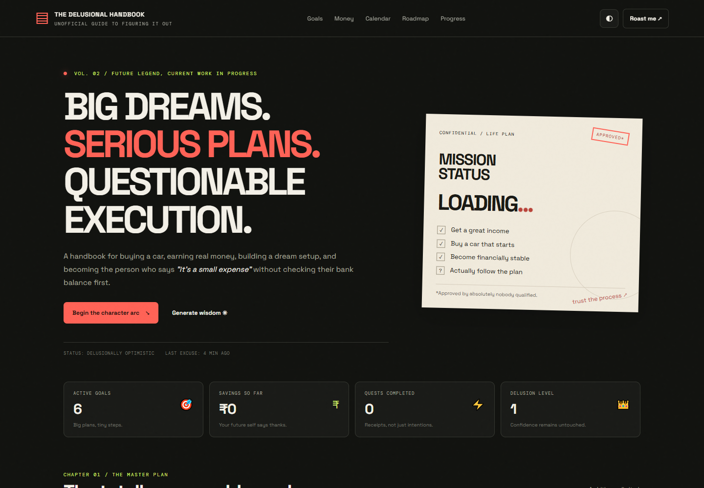

<div align="center">

# The Delusional Handbook

**A sarcastic personal-goals dashboard for people who have big dreams, serious plans, and questionable execution.**

Built with Node.js, Express and vanilla JavaScript. No account, no database, no cloud sync — your data stays in your browser.

<p>
  <a href="https://github.com/KION6969/0tohero/actions/workflows/ci.yml"></a>
  
  
  
  
</p>

[**Live demo →**](https://0tohero-ten.vercel.app) · [Report an issue](https://github.com/KION6969/0tohero/issues)

</div>



## What this is

The Delusional Handbook is a goals dashboard with a sense of humour. It tracks the things you keep saying you'll do — saving money, buying a car, building a skill, actually finishing a project — and wraps them in a dark editorial interface that is significantly more put-together than you are.

Under the jokes it is a real tool: goals persist, savings update, calculators do the math, and the journal keeps a dated record.

## Features

**Dashboard**
- Active goals, savings, completed quests and a "delusion level" summary
- Responsive dark/light theme, remembered between visits

**Goals and progress**
- Six seeded goals plus a custom goal creator
- Progress tracking with per-goal updates
- Weekly quest checklist and achievement badges
- A roadmap with honest, mildly threatening status labels

**Money (in Indian rupees)**
- Savings tracker with target, percentage and remaining-amount math
- Car EMI estimator
- Rent-vs-time calculator
- SIP corpus projector
- Goal timeline calculator
- All values formatted with `Intl.NumberFormat('en-IN')`

**Everything else**
- Monthly calendar with custom events
- Daily journal with a "recent receipts" history
- Random excuse generator, wisdom button and a roast button
- `/api/health` endpoint for uptime checks (yes, this site is monitored by [Pulse](https://github.com/KION6969/pulse-uptime))

## Stack

| Layer | Choice |
| --- | --- |
| Server | Node.js 18+, Express 4 |
| Client | HTML, CSS, vanilla JavaScript — no build step |
| Data | Browser `localStorage` |
| Hosting | Vercel (Express served as a Node function) |

## Run it locally

```bash
git clone https://github.com/KION6969/0tohero.git
cd 0tohero
npm install
npm start
```

Open **http://localhost:3000**. The server serves `public/` and provides the health check:

```bash
curl http://localhost:3000/api/health
```

## Project structure

```
server.js          Express server, static files and /api/health
public/
  index.html       the whole interface
  css/style.css    design system, themes and responsive layouts
  js/app.js        state, localStorage persistence, calculators, UI
```

There is no bundler and no framework. Edit `public/` and refresh.

## Notes and limits

- **Data is local.** Progress lives in `localStorage` for one browser on one device. Clearing site data deletes it. There is no account system or sync.
- **Estimates are estimates.** EMI, rent and SIP figures are illustrative and exclude taxes, insurance, maintenance, fuel and other real-world costs. They are not financial advice.
- **The jokes are the point.** The app is intentionally sarcastic. The goals still work.

## License

MIT © KION6969
